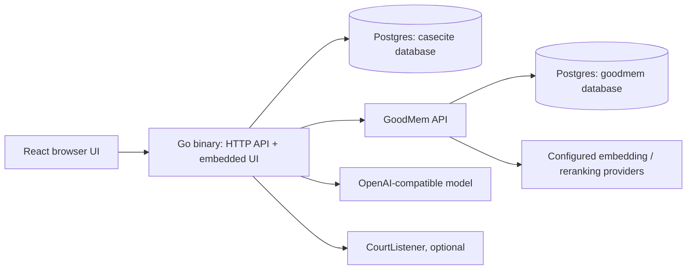

# CaseCite → CaseCite GoodMem

## Decision

Use a separate GitHub fork and a `goodmem-migration` branch. The architecture now diverges enough that a long-lived feature toggle in Thomas's application would make maintenance harder. The fork preserves attribution and ancestry, and the original remains the `upstream` remote.

Thomas's server is Python/FastAPI; its browser UI is React/TypeScript. This edition uses Go for the server and retains React/TypeScript for a smaller interface. A build embeds the frontend in the executable. The app is one binary; GoodMem and Postgres remain services, and model inference is supplied by a configured provider.

## Before / after

| Responsibility | Upstream CaseCite | GoodMem edition |
|---|---|---|
| API and orchestration | Python/FastAPI and substantial service layer | Go `net/http`, explicit handlers and jobs |
| Document ingestion | Local extraction/OCR, chunking and indexing integrations | GoodMem multipart memory ingestion |
| Original documents | Application-managed file paths/storage | GoodMem content API |
| Page previews | Local PDF/document rendering path | GoodMem page metadata and image APIs |
| Retrieval | Application-managed vector backend and embedding options | GoodMem space retrieval and optional reranking |
| Users, matters, history | Application Postgres models | Separate CaseCite database on the shared Postgres instance |
| Sessions / transient state | Redis-backed or in-process coordination paths | SQL sessions and expiring JSONB key/value records |
| Background work | Application task orchestration | Durable SQL jobs, leases, cancellation and bounded Go workers |
| Serving the UI | Separate frontend build/serving infrastructure | React assets embedded in Go executable |
| Enterprise integrations | Connectors, SSO/MFA, Word add-in, workflow builder | Deliberately outside this first implementation |

## What we preserved and traded away

The implementation preserves the common cycle: create a matter, share it, upload sources, inspect originals and page images, research with source passages, review contracts, draft, compare, extract a review table, approve findings, export and reopen work. Personal provider keys, administration and audit events remain available.

The expensive fidelity work is deferred: exact upstream UI/API compatibility; external document connectors and OAuth; SSO/MFA/device authorization; Word add-in; multi-step workflow designer with approvals/versioning; automated deep research and judge intelligence; original-format tracked redlines; and dedicated legal rule engines. These controls are absent from the new UI rather than exposing endpoints that silently do nothing.

This is not a migration of an existing Python database or document corpus. Existing CaseCite installations must export/re-upload documents and explicitly map users/matters. Running this binary against the Python database does not transform its data. A future importer should be driven by an actual source installation and tested fixtures.

## How the important paths work

The two databases can share one Postgres server, disk, backup system and monitoring setup, without sharing application tables or database credentials.

Every uploaded document gets an application ID and a fixed GoodMem memory ID. GoodMem stores the original and page images. The application stores ownership, matter assignment, filename and processing state. Moves between matters change SQL ownership context only; the memory need not be re-embedded. Deletion removes the GoodMem memory first and is safe to retry if the following SQL operation fails.

Before retrieval, CaseCite selects authorized document records and passes an explicit memory-ID metadata filter to GoodMem. It validates every returned memory ID again. Empty selection produces no unfiltered query. Matter revocation also prevents opening saved results whose source dependencies are no longer accessible, including dependencies inherited by follow-up questions. Source passages are evidence, never instructions to the model.

The optional GoodMem reranker supplies the final result set; the client avoids mixing raw and reranked stages. Raw scores are retained for diagnostics, not converted into invented confidence percentages. Exact quotation checking is separate from legal interpretation.

The `cc_kv` table provides JSON values with expirations, atomic insert-if-absent, and fixed-window counters. SQL sessions handle login expiration and revocation. Durable jobs use `FOR UPDATE SKIP LOCKED`, bounded concurrency, short leases and heartbeat renewal. Expired leases fail explicitly instead of silently replaying potentially billable model calls. This is sufficient for a firm-scale deployment; it is not intended to emulate every Redis operation.

## Is the juice worth the squeeze?

**Yes for the document-centric product.** GoodMem removes the largest duplicated subsystem: ingestion, indexing, vector storage, full-file storage and page images. Go turns the application into a much smaller deployment artifact. Sharing the existing Postgres service removes another infrastructure dependency without making GoodMem responsible for application sessions or authorization.

The benefit is mainly lower code and operational complexity. It does not make embedding, OCR, retrieval or generation free; those costs move into GoodMem and model providers. Sharing Postgres also shares failure and resource contention, so use distinct connection pools, roles and databases and back them up together.

**No if “90%” means nearly all of the upstream enterprise feature surface.** Rebuilding all connectors, Word editing fidelity, MFA, legal-specific rule coverage and workflow machinery in Go would erase much of the savings. The sensible boundary is the complete, narrower application delivered here. Measure answer quality and workflow coverage on representative legal documents before calling it 90% equivalent; no such corpus benchmark was performed as part of this implementation.
