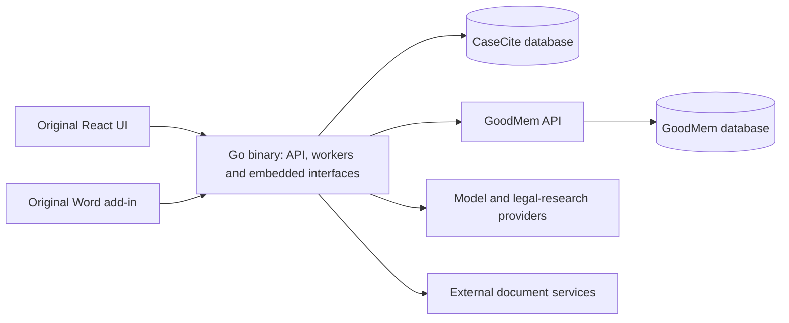

# CaseCite → CaseCite GoodMem

## Decision and scope

Use the separate `PAIR-Systems-Inc/casecite-goodmem` repository and its
`goodmem-migration` branch. Retain the original history and `upstream` remote.
The original server is Python/FastAPI; its browser UI is React/TypeScript.
The new server is Go, with the original browser UI and Word add-in embedded in
the binary. GoodMem and PostgreSQL remain separate services.

Full upstream functionality and a UI at least as capable as the original are
required. The earlier reduced-scope approach is superseded. This is a port in
progress, not a completed feature-parity release. Known upstream defects may
be fixed; intentional differences need tests and an explanation.

## Architecture before and after

| Responsibility | Original CaseCite | Go/GoodMem architecture |
|---|---|---|
| API and orchestration | Python/FastAPI service layer | Go HTTP handlers and workers in one executable |
| Browser UI | React/TypeScript | Original React/TypeScript UI embedded in the executable |
| Word add-in | Separate add-in build and deployment | Original add-in embedded at `/word-addin/`, with a deployment-specific manifest |
| Ingestion, chunking, embedding and vector retrieval | Application integrations and local processing | GoodMem memory and retrieval APIs |
| Original files and page images | Application-managed storage and rendering | GoodMem content and page-image APIs |
| Application records | Application PostgreSQL database | Separate CaseCite database/role on the same PostgreSQL instance as GoodMem |
| Sessions and expiring state | Redis and application coordination | PostgreSQL sessions, expiring JSONB records, counters and one-time tokens |
| Background work | Python task machinery | PostgreSQL queue, worker leases, progress and cancellation; workers run inside Go |
| Authentication | Local login, Microsoft SSO, MFA and device flow | Same required capabilities, with Go protocol and integration tests |
| Tabular review | Python extraction, review persistence and workbook generation | Go extraction with verified quotes, PostgreSQL review/history, original grid UI and cited workbook exports |
| Connectors, legal tools and workflows | Original implementations | Required ports; unfinished work remains explicitly tracked |
| Tracked DOCX export | Reconstructed plain-text document with revisions | Edits to the original OOXML package, retaining unrelated formatting and parts |

The bundled steady-state deployment has three services: CaseCite, GoodMem and
PostgreSQL, plus a one-time setup command. The application is one binary; that
does not make the entire system one process. Existing TLS infrastructure and
model providers are external dependencies.

Line counts and “10× less effort” are not acceptance criteria. A short rewrite
that omits features is not an equivalent implementation. Do not compare the
original complete product against an unfinished subset and present the
difference as an achieved efficiency gain.

The databases share one PostgreSQL instance while retaining distinct roles,
schemas, connection pools and application ownership. No Redis extension or
access to GoodMem's internal tables is needed.

## Boundaries that stay explicit

CaseCite stores ownership, matter membership, settings, sessions, jobs and
workflow state. Each document record points to its GoodMem memory. Access
checks happen before fetching originals/page images and before retrieval;
returned memory IDs are checked against the authorized scope. Moving a
document between matters does not require re-embedding it.

GoodMem performs ingestion, embeddings, retrieval and page rendering. Its full
document and page-image APIs replace duplicate application storage. This does
not eliminate provider charges or make extraction/semantic quality automatic.
Sharing PostgreSQL also shares resource contention and failure modes.

Durable jobs use `FOR UPDATE SKIP LOCKED`, short renewable leases, progress,
explicit cancellation and bounded concurrency. Saved analyses commit with
successful job completion. Review tables retain completed document rows during
a run, as upstream does; each row write checks the current job lease, table
scope and permissions. Expired worker leases fail visibly instead of
silently replaying potentially billable model calls.

An existing Python database is not migrated by pointing this binary at it.
An importer requires an explicit source schema/corpus and validation. Until
that exists, use a separate database and explicit document/user migration.

## Is the work worth it?

GoodMem removes a substantial duplicated document subsystem. Go consolidates
application deployment and workers into one executable, and shared PostgreSQL
removes a separate Redis dependency. Those are concrete architectural benefits.

Full feature parity still requires connectors, identity, legal tools, workflow
execution, the Word experience and UI verification. The savings come from
reusing GoodMem and the existing React/add-in code, not from deleting those
features. It is reasonable to pursue this architecture, but it would be
misleading to promise a tenfold total implementation saving before the port
and its verification are complete.

See [the parity scope](parity/README.md) and
[verification evidence](parity/evidence.md) for current progress and limits.
