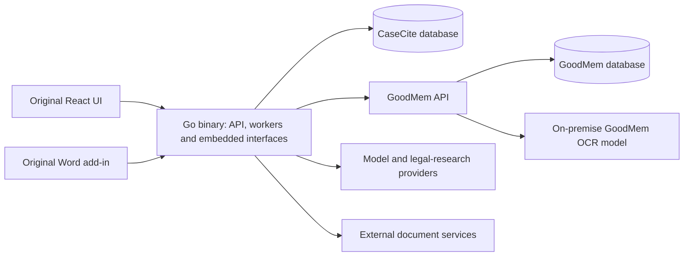

# CaseCite → CaseCite GoodMem

## Decision and scope

Use the separate `PAIR-Systems-Inc/casecite-goodmem` repository and its
`goodmem-migration` branch. Retain the original history and `upstream` remote.
The original server is Python/FastAPI; its browser UI is React/TypeScript.
The new server is Go, with the original browser UI and Word add-in embedded in
the binary. GoodMem and PostgreSQL remain separate services.

Full upstream functionality and a UI at least as capable as the original are
required. The earlier reduced-scope approach is superseded. This is a port in
progress, not a completed feature-parity release. Known upstream defects may
be fixed; intentional differences need tests and an explanation.

## Architecture before and after

| Responsibility | Original CaseCite | Go/GoodMem architecture |
|---|---|---|
| API and orchestration | Python/FastAPI service layer | Go HTTP handlers and workers in one executable |
| Browser UI | React/TypeScript | Original React/TypeScript UI embedded in the executable |
| Word add-in | Separate add-in build and deployment | Original add-in embedded at `/word-addin/`, with a deployment-specific manifest |
| Ingestion, chunking, embedding and vector retrieval | Application integrations and local processing | GoodMem memory and retrieval APIs |
| Original files and page images | Application-managed storage and rendering | GoodMem content and page-image APIs |
| Scanned and mixed PDFs | Optional local Tesseract fallback, with sparse-page heuristics | GoodMem on-premise OCR API, complete-page checks, shared text cache and durable indexing back into GoodMem |
| Application records | Application PostgreSQL database | Separate CaseCite database/role on the same PostgreSQL instance as GoodMem |
| Sessions and expiring state | Redis and application coordination | PostgreSQL sessions, expiring JSONB records, counters and one-time tokens |
| Background work | Python task machinery | PostgreSQL queue, worker leases, progress and cancellation; workers run inside Go |
| Authentication | Local login, Microsoft SSO, MFA and device flow | Same required capabilities, with Go protocol and integration tests |
| Tabular review | Python extraction, review persistence and workbook generation | Go extraction with verified quotes, PostgreSQL review/history, original grid UI and cited workbook exports |
| Saved workflows | Python orchestration, versions, approvals and notifications | Go step adapters, frozen versions, transactional PostgreSQL queue/approval decisions, and encrypted email outbox |
| Connectors and standalone legal tools | Original implementations | Eight connector adapters, four file pickers and all legal-tool routes implemented in Go; live tenant acceptance remains open |
| Tracked DOCX export | Reconstructed plain-text document with revisions | Edits to the original OOXML package, retaining unrelated formatting and parts |

The bundled application deployment has three services: CaseCite, GoodMem and
PostgreSQL, plus a one-time setup command. GoodMem's OCR model/add-on must also
run on the local infrastructure. The application is one binary; that does not
make the entire system one process. Existing TLS infrastructure, OCR compute,
and embedding/generation models remain dependencies.

Line counts and “10× less effort” are not acceptance criteria. A short rewrite
that omits features is not an equivalent implementation. Do not compare the
original complete product against an unfinished subset and present the
difference as an achieved efficiency gain.

The databases share one PostgreSQL instance while retaining distinct roles,
schemas, connection pools and application ownership. No Redis extension or
access to GoodMem's internal tables is needed.

## Measured footprint

Snapshot of the legacy-format implementation on 2026-10-30, compared with the
pinned original commit. These are current measurements, not a promise of
completed parity, lower latency or tenfold development savings.

| Measure | Original | Go/GoodMem port | Practical benefit |
|---|---|---|---|
| Application server | Python/FastAPI | Go | One compiled application executable, including workers and built interfaces |
| Server source files | 208 | 118 | A smaller application codebase to maintain |
| Physical server source lines | 58,135 | 30,488 | About 48% fewer lines in the measured server directories |
| Core persistent services, excluding TLS and model runtimes | 3: application, PostgreSQL, Redis | 3: application, GoodMem, PostgreSQL | Redis is removed; GoodMem centralizes the document subsystem |
| Application runtime | Python and installed packages; application container also serves assets with nginx | Go executable serving API, workers and embedded assets | No Python, Node or nginx runtime inside the application container |
| Redis deployment | Required | None | Expiring keys, sessions and job coordination share PostgreSQL |
| Document persistence | Application upload directory and Chroma, plus PostgreSQL | GoodMem API and shared PostgreSQL instance | One document service owns originals, page images and search indexes |
| Application OCR dependency | Tesseract integration | GoodMem on-premise OCR API | Reuses the organization's OCR service and its model deployment |

Line counts include comments and blank lines. The original scope is
`backend/app/**/*.py`; the Go scope is `server/internal/app/**/*.go` and
`server/cmd/casecite/**/*.go`, excluding `*_test.go`. Both exclude the UI,
build tools and test corpus; the Go count excludes SQL/assets and GoodMem's own
implementation. Delegating code to GoodMem shifts maintenance rather than making
that code disappear. These counts should not be read as an equal-feature
complexity benchmark until acceptance is complete.

The original production Compose file has four long-running containers when
Caddy is included, plus a one-time UI build. This port also needs TLS termination
in production. Counting that consistently gives four services on each side;
the OCR model and generation/embedding endpoints are additional dependencies.
The benefit is consolidation and reuse, not a demonstrated “five servers to two.”

## Boundaries that stay explicit

CaseCite stores ownership, matter membership, settings, sessions, jobs and
workflow state. Each document record points to its original GoodMem memory;
scanned/mixed PDFs and older Excel files also have a GoodMem memory for their
searchable extracted text. Access
checks happen before fetching originals/page images and before retrieval;
returned memory IDs are checked against the authorized scope. Moving a
document between matters does not require re-embedding it.

GoodMem performs ingestion, OCR, embeddings, retrieval and page rendering. Its full
document and page-image APIs replace duplicate application storage. This does
not eliminate provider charges or make extraction/semantic quality automatic.
Sharing PostgreSQL also shares resource contention and failure modes.

Durable jobs use `FOR UPDATE SKIP LOCKED`, short renewable leases, progress,
explicit cancellation and bounded concurrency. Saved analyses commit with
successful job completion. Review tables retain completed document rows during
a run, as upstream does; each row write checks the current job lease, table
scope and permissions. Expired worker leases fail visibly instead of
silently replaying potentially billable model calls.

Workflow runs publish each step's outputs and generated work products together.
Completed steps survive failure; resuming reuses them. Approval decisions and
continuation jobs commit together, so concurrent approvals cannot enqueue the
same continuation twice. Waiting for approval uses no worker or expiring lease.

An existing Python database is not migrated by pointing this binary at it.
An importer requires an explicit source schema/corpus and validation. Until
that exists, use a separate database and explicit document/user migration.

## Is the work worth it?

GoodMem removes a substantial duplicated document subsystem. Go consolidates
application deployment and workers into one executable, and shared PostgreSQL
removes a separate Redis dependency. Those are concrete architectural benefits.

The ports of connectors, identity, legal tools, workflows and the Word experience
are implemented, with protocol, database and browser tests. Complete live-provider,
Word-host and UI acceptance still remain. The savings come from
reusing GoodMem and the existing React/add-in code, not from deleting those
features. It is reasonable to pursue this architecture, but it would be
misleading to promise a tenfold total implementation saving before the port
and its verification are complete.

See [the parity scope](parity/README.md) and
[verification evidence](parity/evidence.md) for current progress and limits.
